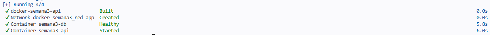
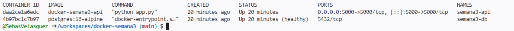
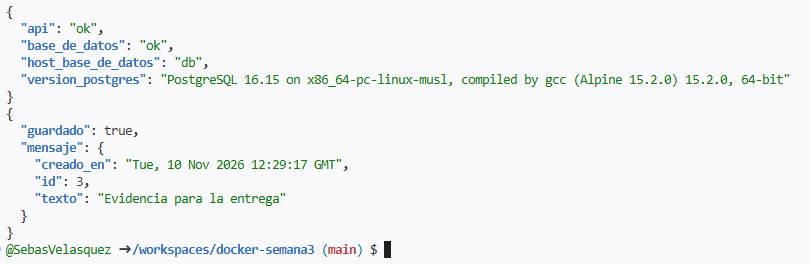
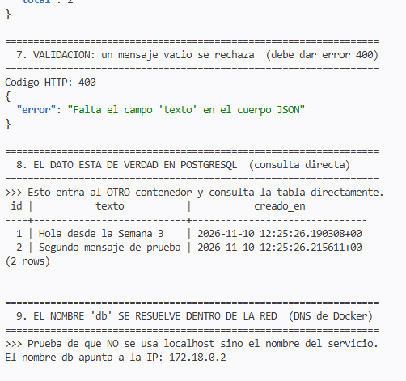

# Entrega — Semana 3

**Actividad:** usar Docker para construir dos contenedores que estén
comunicados entre sí.

**Integrantes del grupo:** Sebastián Velásquez
**Repositorio:** https://github.com/SebasVelasquez/docker-semana3
**Fecha en que se hicieron las pruebas:** 10 de noviembre de 2026

---

## 1. Lo que hicimos, en pocas palabras

Montamos dos programas que trabajan juntos, cada uno dentro de su propia caja,
y conseguimos que se hablen entre ellos.

Antes de seguir, conviene aclarar qué es una de esas cajas. **Un contenedor es
un paquete cerrado que lleva dentro un programa y todo lo que ese programa
necesita para funcionar**: la versión exacta del lenguaje, las librerías, la
configuración. La ventaja es que funciona igual en cualquier computador,
porque no depende de lo que cada uno tenga instalado. Docker es el programa
que crea y maneja esas cajas.

Nosotros hicimos dos:

| | La caja | Qué hay dentro | Cómo la conseguimos |
|---|---|---|---|
| **1** | `semana3-api` | Un programa en Python que recibe mensajes, los guarda y los devuelve cuando se los piden | La construimos nosotros |
| **2** | `semana3-db` | Una base de datos PostgreSQL, que es donde quedan guardados esos mensajes | La descargamos ya hecha |

**La clave de la actividad está en que la primera caja no guarda nada por su
cuenta.** Todo lo escribe y lo lee en la segunda. Si las dos no se estuvieran
hablando, la primera no podría responder nada. Por eso, el simple hecho de que
funcione ya demuestra que hay comunicación entre ellas.

---

## 2. Cómo consiguen hablarse

Esta es la parte central de la actividad, así que la explicamos despacio.

```
          nuestro computador
                  │
                  │  http://localhost:5000
                  ▼
   ┌──────────────────────────────────────────────┐
   │        la red privada:  "red-app"            │
   │                                              │
   │   ┌───────────────┐      ┌────────────────┐  │
   │   │  semana3-api  │─────▶│   semana3-db   │  │
   │   │   el programa │      │  la base de    │  │
   │   │               │      │     datos      │  │
   │   └───────────────┘      └────────────────┘  │
   │     se llama "api"         se llama "db"     │
   └──────────────────────────────────────────────┘
```

### Primero: las pusimos en la misma red

Docker permite crear **redes privadas**, que funcionan parecido a una red wifi
de casa: los aparatos conectados a ella se ven entre sí, y los de fuera no
entran. Creamos una red a la que llamamos `red-app` y conectamos las dos cajas.

### Segundo: se buscan por su nombre, no por un número

Normalmente, para que un programa encuentre a otro en una red hace falta saber
su dirección, que es un número tipo `172.18.0.2`. El problema es que ese número
cambia cada vez que se reinicia, así que no sirve escribirlo a mano.

Docker resuelve esto con algo parecido a **la agenda de contactos del
teléfono**: en vez de memorizar el número, guardas el nombre y el teléfono lo
busca por ti. Dentro de la red, cada caja tiene un nombre —las llamamos `api` y
`db`— y basta con usar ese nombre.

Por eso, en la configuración del programa pusimos simplemente:

```
DB_HOST: db
```

> **El error más común al empezar con Docker** es poner ahí `localhost`.
> `localhost` significa "yo mismo". Dentro de una caja, `localhost` es *esa
> misma caja*. Si el programa buscara la base de datos en `localhost`, se
> estaría buscando a sí mismo, y ahí no hay ninguna base de datos. Sería como
> buscar a un amigo llamándote a tu propio teléfono.

### Tercero: la base de datos no está abierta al exterior

Decidimos que **solo el programa** se pueda ver desde fuera. La base de datos
no: a ella únicamente se llega desde dentro de la red privada.

Lo hicimos por dos razones. La primera es de seguridad: una base de datos
abierta a todo el mundo es un riesgo innecesario. La segunda sirve para esta
actividad: si la base de datos estuviera abierta, se podría dudar de si la
comunicación pasa de verdad por la red de Docker. Estando cerrada, no queda
duda posible.

---

## 3. Cómo lo construimos, paso a paso

### Paso 1 — Escribir el programa

Hicimos un programa pequeño en Python, usando una herramienta llamada Flask
que sirve para crear este tipo de aplicaciones. Tiene cuatro funciones, cada
una con su propia dirección web:

| Dirección | Qué hace |
|---|---|
| `/` | Una página de bienvenida: sirve para comprobar que el programa está despierto |
| `/salud` | Le pregunta a la base de datos cómo se llama y qué versión tiene — **esto es lo que prueba que se hablan** |
| `/mensajes` (enviar) | Guarda un mensaje nuevo |
| `/mensajes` (consultar) | Devuelve todos los mensajes guardados |

Dentro del programa tuvimos que resolver dos cosas que no son evidentes:

**Que el programa escuche a los de fuera.** Por defecto, estos programas solo
se escuchan a sí mismos. Hay que decirle expresamente que acepte visitas de
fuera de su caja; si no, queda incomunicado aunque todo lo demás esté bien.

**Que espere a que la base de datos esté lista.** Una base de datos tarda unos
segundos en arrancar, igual que un computador no está listo en cuanto le das
al botón. Si el programa intenta conectarse antes de tiempo, falla y se apaga.
Así que le pusimos instrucciones para que reintente hasta 30 veces antes de
rendirse.

### Paso 2 — Escribir la receta de la caja

Para que Docker pueda construir una caja hay que darle una receta, paso por
paso, como si fuera de cocina. Se guarda en un archivo llamado `Dockerfile`:

```dockerfile
FROM python:3.12-slim      # parte de una caja que ya trae Python
WORKDIR /app               # trabaja en esta carpeta
COPY requirements.txt .    # mete la lista de librerías que hacen falta
RUN pip install --no-cache-dir -r requirements.txt   # e instálalas
COPY app.py .              # ahora mete el programa
EXPOSE 5000                # avisa de que escucha en el número 5000
CMD ["python", "app.py"]   # y al encender la caja, arranca el programa
```

**¿Por qué metemos primero la lista de librerías y después el programa?**
Porque Docker **guarda el trabajo que ya hizo** para no repetirlo. Si luego
cambiamos algo del programa pero no de las librerías, no vuelve a
descargarlas: reutiliza lo que ya tenía.

Y esto no es teoría: se notó muchísimo. **La primera vez que construimos la
caja tardó 19,8 segundos. La segunda, 0,5 segundos.**

### Paso 3 — Decirle a Docker cómo encajan las dos cajas

Falta explicarle a Docker que son dos cajas, que van en la misma red, cuál
arranca primero y dónde se guardan los datos. Todo eso va en un archivo
llamado `docker-compose.yml`:

```yaml
services:
  db:                                # la base de datos
    image: postgres:16-alpine        # usa esta, ya hecha
    container_name: semana3-db
    environment:                     # su usuario y su contraseña
      POSTGRES_USER: ${POSTGRES_USER}
      POSTGRES_PASSWORD: ${POSTGRES_PASSWORD}
      POSTGRES_DB: ${POSTGRES_DB}
    volumes:
      - datos-db:/var/lib/postgresql/data    # dónde guarda la información
    networks: [red-app]              # conéctala a la red
    healthcheck:                     # y pregúntale cada 5 s si ya está lista
      test: ["CMD-SHELL", "pg_isready -U ${POSTGRES_USER} -d ${POSTGRES_DB}"]
      interval: 5s
      timeout: 5s
      retries: 10

  api:                               # el programa
    build: ./api                     # constrúyelo con nuestra receta
    container_name: semana3-api
    environment:
      DB_HOST: db                    # <-- el NOMBRE de la otra caja
      DB_PORT: 5432
      DB_USER: ${POSTGRES_USER}
      DB_PASSWORD: ${POSTGRES_PASSWORD}
      DB_NAME: ${POSTGRES_DB}
    ports:
      - "${API_PORT}:5000"           # esto sí lo abrimos al exterior
    depends_on:
      db:
        condition: service_healthy   # no arranques hasta que la otra esté lista
    networks: [red-app]

networks:
  red-app:                           # la red privada que comparten

volumes:
  datos-db:                          # el "disco" donde quedan los datos
```

Tres detalles que vale la pena señalar:

- **La espera está resuelta dos veces.** Docker le pregunta a la base de datos
  cada cinco segundos si ya puede atender, y no enciende el programa hasta que
  responde que sí. Además, el propio programa reintenta por su cuenta. Es una
  precaución doble a propósito, porque es justo donde suele fallar todo.

- **Los datos se guardan aparte de la caja.** Si tiramos la caja y la volvemos
  a crear, los mensajes siguen ahí. Es como tener los archivos en un disco
  externo en vez de dentro del computador.

- **La base de datos no tiene la línea que la abre al exterior.** Es
  intencionado, como explicamos antes.

### Paso 4 — Guardar las contraseñas donde no se vean

**Las contraseñas no están escritas en el código.** Están en un archivo aparte
llamado `.env`, que se queda en el computador de cada uno y **nunca se sube a
internet**.

Para que cualquiera sepa qué datos necesita sin que nadie revele los suyos,
dejamos un segundo archivo, `.env.example`, que es una plantilla: dice qué
hace falta rellenar, pero con valores de mentira.

| Archivo | ¿Se sube? | Qué lleva |
|---|---|---|
| `.env` | ❌ No | Las contraseñas de verdad |
| `.env.example` | ✅ Sí | La plantilla vacía, para que otro sepa qué poner |

Para asegurarnos de que el archivo con las contraseñas no se subiera por
descuido, lo añadimos a la lista de archivos ignorados y además **buscamos la
contraseña dentro de todo lo que íbamos a subir**: no aparece en ninguno.

---

## 4. Cómo se pone en marcha

```bash
git clone https://github.com/SebasVelasquez/docker-semana3.git
cd docker-semana3

cp .env.example .env          # crear el archivo de contraseñas
# (abrir .env y poner una contraseña propia)

docker compose up --build -d  # construir y encender las dos cajas
```

Y para comprobarlo o apagarlo:

```bash
docker ps              # ver las dos cajas encendidas
./probar.sh            # lanzar todas las pruebas de golpe
docker compose down    # apagar
```

---

## 5. Las pruebas que hicimos

Lo ejecutamos en **GitHub Codespaces**, que es un computador prestado que
funciona dentro del navegador. Lo usamos porque en los equipos donde
trabajamos no teníamos permisos para instalar Docker.

### Prueba 1 — Las dos cajas se construyen y encienden



Se ve cómo Docker construye la caja del programa, crea la red y enciende las
dos. Lo importante está en las dos últimas líneas: la base de datos aparece
como **`Healthy`**, es decir, ya contesta. Y solo después de eso arranca el
programa. Es exactamente el orden que habíamos pedido.

### Prueba 2 — Comprobar que están funcionando



Este comando lista las cajas que están encendidas en ese momento. Aparecen las
dos, y llevan un rato funcionando sin caerse.

**Lo que hay que mirar está en la columna de la derecha, la de los puertos:**

- El programa (`semana3-api`) tiene una flecha: `0.0.0.0:5000->5000`. Esa
  flecha significa que está abierto y se puede entrar desde fuera.
- La base de datos (`semana3-db`) solo dice `5432`, **sin flecha**. No está
  abierta. A ella solo se llega desde dentro de la red privada.

### Prueba 3 — El programa alcanza a la base de datos



Aquí le pedimos dos cosas al programa.

**La primera es la prueba más directa de toda la actividad.** Le pedimos que
le preguntara a la base de datos quién es. Esto es lo que respondió:

```json
{
  "api": "ok",
  "base_de_datos": "ok",
  "host_base_de_datos": "db",
  "version_postgres": "PostgreSQL 16.15 ..."
}
```

Se conectó usando el nombre **`db`**, y la base de datos le contestó diciendo
su versión. **Ese dato no se puede inventar: viene de la otra caja.** Si no se
estuvieran hablando, ahí habría un error.

**La segunda** fue enviarle un mensaje para que lo guardara. Respondió que lo
había guardado, y de paso devolvió el número que le asignó la base de datos y
la hora exacta en que lo hizo.

### Prueba 4 — El mensaje está de verdad dentro de la otra caja



Esta captura cierra la demostración, y tiene dos partes.

**Arriba**, entramos directamente a la caja de la base de datos y le pedimos
que nos enseñara lo que tiene guardado, sin pasar por el programa. Ahí están
los dos mensajes que habíamos enviado antes. Es decir: **lo que entró por una
caja terminó físicamente dentro de la otra.** Si no hubiera comunicación entre
ellas, esa lista estaría vacía.

**Abajo**, le pedimos al programa que buscara a quién corresponde el nombre
`db`. Contestó `172.18.0.2`, que es una dirección de la red privada. Ese
nombre no existe en internet ni en ningún computador de fuera: solo existe
dentro de la red que creamos.

De regalo, en la misma captura se ve una tercera comprobación: si se intenta
guardar un mensaje vacío, el programa lo rechaza con un aviso de error en vez
de guardar basura.

---

## 6. Un fallo que apareció al ejecutarlo, y cómo lo arreglamos

La primera vez que lanzamos las pruebas, varias líneas devolvieron esto:

```
python3: command not found
```

**Qué pasaba.** Para que las respuestas se vieran ordenadas en pantalla,
usábamos una herramienta que viene con Python. Pero el computador prestado
donde estábamos trabajando **no tenía Python instalado**. Las pruebas sí
funcionaban —los mensajes llegaban a la base de datos— pero las respuestas no
se alcanzaban a mostrar.

**Cómo lo arreglamos.** En vez de dar por hecho que esa herramienta está en
todas partes, cambiamos las instrucciones para que primero miren qué hay
disponible y usen lo que encuentren. Si no encuentran nada, al menos enseñan
la respuesta sin ordenar, pero nunca la pierden.

**Qué aprendimos.** El programa estaba bien escrito y no tenía ningún error de
forma. El fallo solo apareció al ejecutarlo de verdad. No se puede dar por
sentado qué herramientas trae un computador que no es el propio.

---

## 7. Qué hay en el repositorio

```
docker-semana3/
├── api/
│   ├── Dockerfile          la receta para construir la caja del programa
│   ├── app.py              el programa
│   └── requirements.txt    la lista de librerías que necesita
├── evidencias/             las capturas de este documento
├── .env                    las contraseñas (NO se sube)
├── .env.example            la plantilla de contraseñas (sí se sube)
├── .gitignore              la lista de lo que no se debe subir
├── docker-compose.yml      cómo encajan las dos cajas
├── probar.sh               lanza todas las pruebas de golpe
├── ENTREGA.md              este documento
└── README.md               las instrucciones del proyecto
```

---

## 8. Resumen de lo que pedía la actividad

| Lo que se pedía | Dónde se ve |
|---|---|
| Dos contenedores hechos con Docker | Prueba 1 y prueba 2 |
| Que se comuniquen entre ellos | Pruebas 3 y 4 |
| La receta del contenedor del programa | `api/Dockerfile`, explicado en el paso 2 |
| El archivo que levanta los dos a la vez | `docker-compose.yml`, explicado en el paso 3 |
| Que estén en la misma red y se llamen por su nombre | Sección 2 y prueba 4 |
| Contraseñas en un archivo aparte, sin subirlas | Paso 4 |
| Una función que guarde y consulte en la base de datos | Pruebas 3 y 4 |
| Ejecutarlo de verdad | Prueba 1 |
| Probarlo y corregir los errores que salgan | Pruebas 3 y 4, y el fallo de la sección 6 |
| Documentación del proyecto | `README.md` |
| Todo subido a GitHub | github.com/SebasVelasquez/docker-semana3 |

---

## Pequeño glosario

Por si alguna palabra no quedó clara:

| Palabra | Qué significa aquí |
|---|---|
| **Contenedor** | Una caja cerrada con un programa dentro y todo lo que necesita para funcionar |
| **Imagen** | La plantilla a partir de la cual se crea una caja. Una imagen puede dar muchas cajas iguales |
| **Docker** | El programa que crea y maneja esas cajas |
| **Dockerfile** | La receta, paso a paso, para construir una caja |
| **Docker Compose** | La herramienta que maneja varias cajas a la vez y las conecta |
| **Puerto** | Un número que identifica por dónde entra o sale la información de un programa |
| **PostgreSQL** | Un programa de base de datos, de los más usados |
| **Flask** | Una herramienta de Python para hacer programas que responden por internet |
| **Volumen** | Un espacio donde se guardan datos que no se borran aunque la caja desaparezca |
